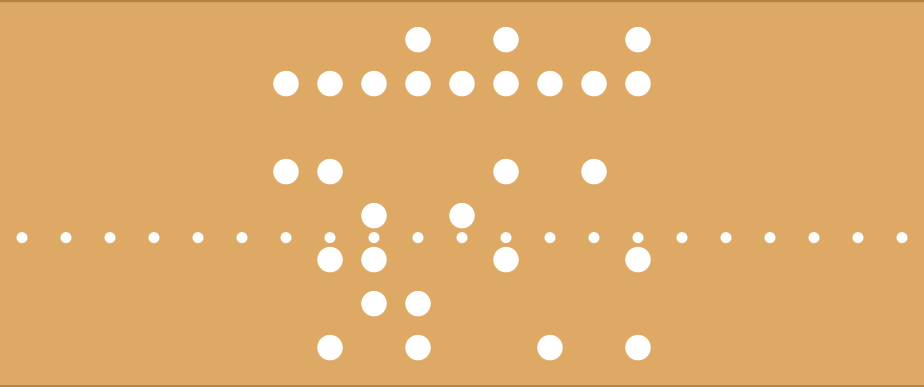
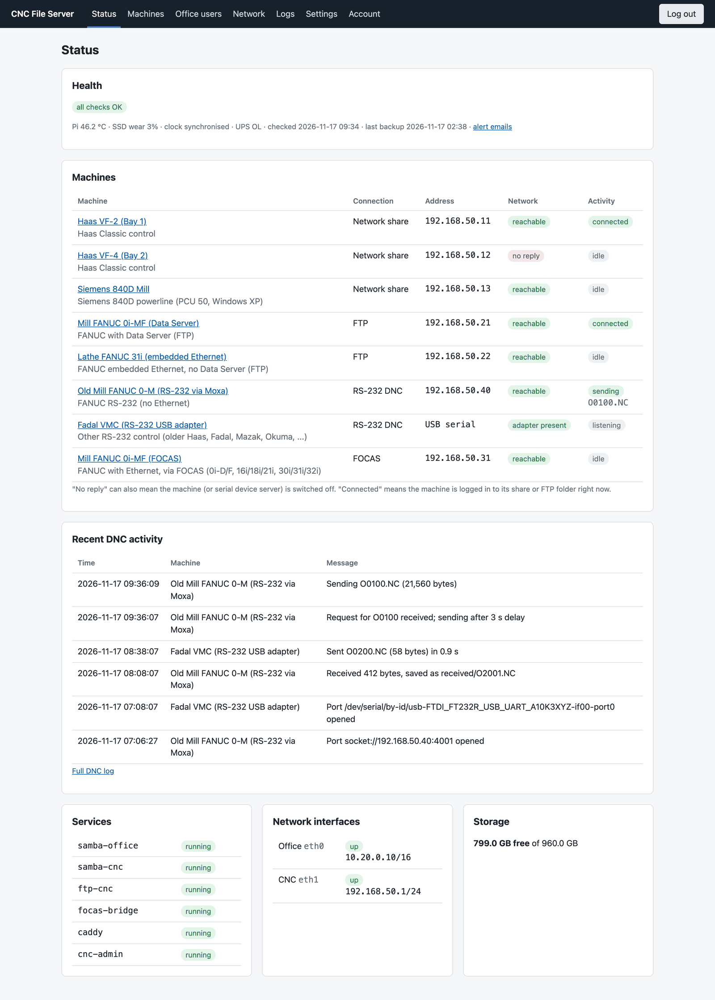
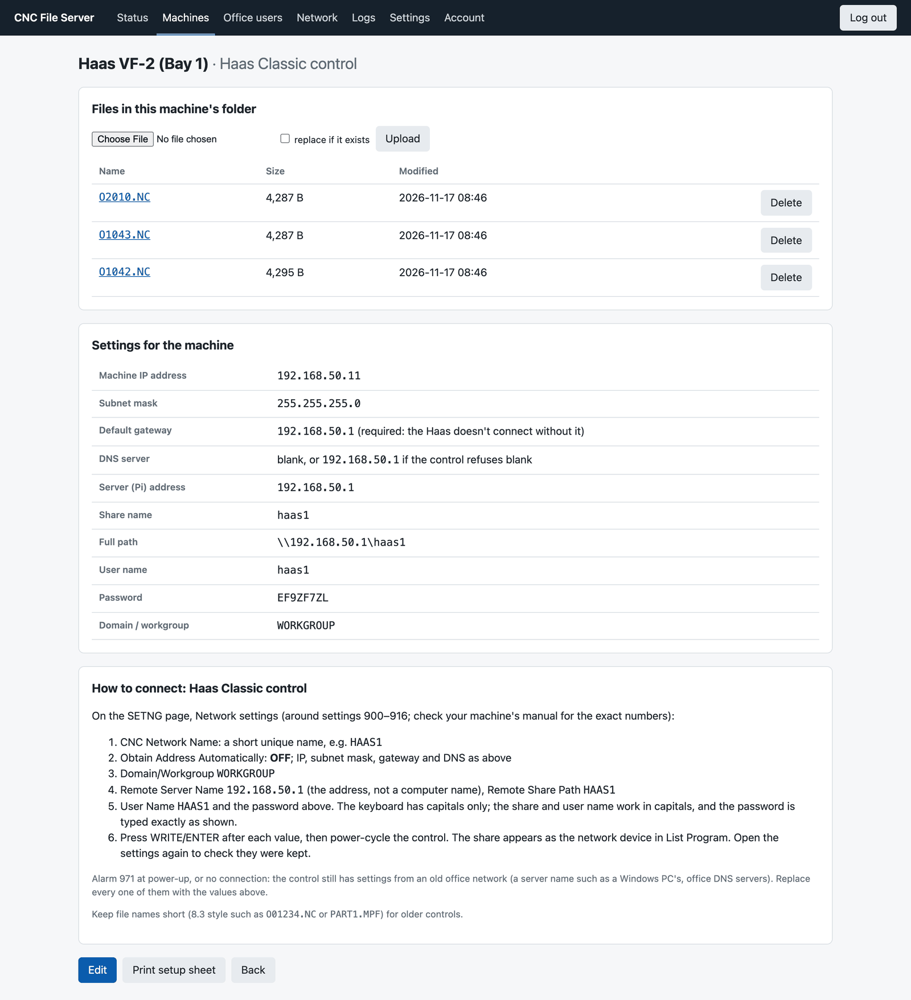
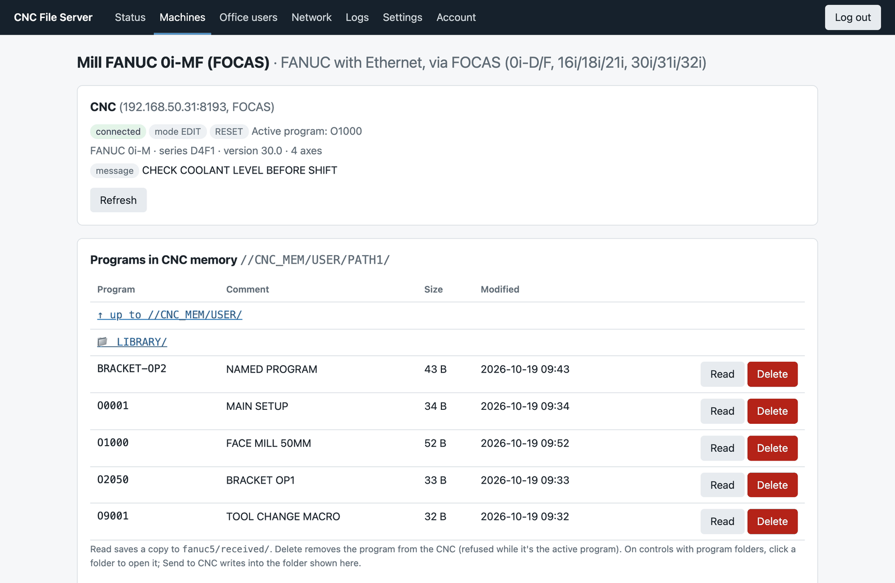
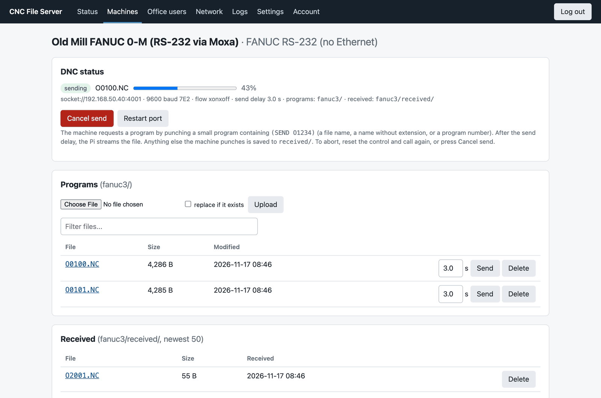
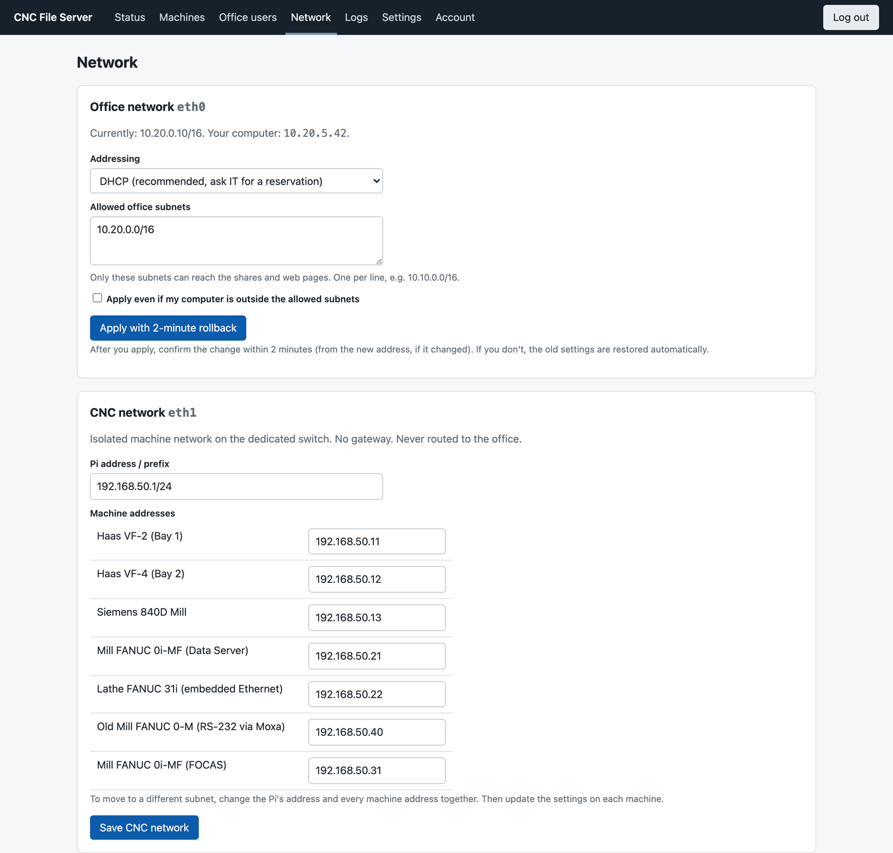
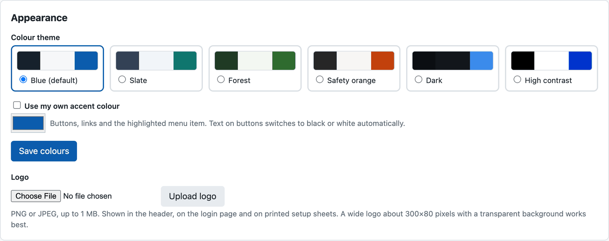

<p align="center">
  
</p>

# PunchTape

**An open-source DNC server and CNC file server for Haas, FANUC, Siemens, Heidenhain,
Mazak, Okuma and Fadal controls — SMB, FTP, FOCAS and RS-232 drip-feed from a Raspberry Pi
or any Linux box.**

Old controls read their programs from punched paper tape. Their descendants still speak
SMB1, plain FTP and RS-232. PunchTape is the modern tape reader: it serves programs to
machines that only speak those protocols, while the office side sees nothing but encrypted
SMB3.

<sub>The holes in the logo are real: eight-level tape, 7-bit ASCII on tracks 1–7 with an
even-parity bit on track 8, feed hole between tracks 3 and 4. They spell `PUNCHTAPE`.
Regenerate it with `python3 tools/make_logo.py`.</sub>

A set of Docker containers that lets old CNC machines share programs with the office
**without exposing insecure protocols on the office network**. It runs on any Linux machine
with Docker Engine and two network ports: a Raspberry Pi 5 is the reference hardware (and
what "the Pi" means below), an x86-64 mini PC or a VM works too
([other hosts](docs/INSTALL.md#other-hosts-not-a-pi)).

Many CNC controls can only use SMB1 (Windows file sharing from the early 2000s), plain
FTP, or an RS-232 serial cable. SMB1 is insecure and should not be on an office
network. This server sits between the two:

```
 Office LAN                                         Dedicated CNC switch (192.168.50.0/24)
 ──────────                                         ─────────────────────────────────────
 Office PCs ──SMB3 (encrypted)──▶ eth0 ┌──────────────┐ eth1 ◀──SMB1/2/3── Haas, Siemens, Heidenhain…
 Browser ─────HTTPS (admin)─────▶      │ Linux server │      ◀──FTP─────── FANUC Data Server / embedded
                                       │ (Pi 5 or PC) │
                                       │ 192.168.50.1 │      ───FOCAS────▶ FANUC with Ethernet
                                       │              │      ───TCP──────▶ serial device server ─RS-232─▶ old CNC
                                       │              │ USB ─RS-232──────────────────────────────────────▶ old CNC
                                       └──────────────┘
                                    /srv/cnc/<machine>/   (one folder per machine)
```

- Office users map one encrypted SMB3 share (`\\<pi>\CNC`), logging in as `CNC-FILES\<user>`,
  with one folder per machine.
- Each machine reaches **only its own folder**, over whatever its control supports.
- Files flow both ways: drop a program in the office, run it at the machine; save at
  the machine, see it in the office. Nothing is copied: every protocol serves the same folders.
- The CNC network is a separate physical switch on the Pi's second network port.
  The Pi **never routes** between the two networks, and the CNC side has no gateway.
- Everything is managed from a web page: machines, users, network settings, live
  status, serial DNC, FOCAS, logs.

> **Status:** fully tested in a simulated environment (see [Testing](#testing)), and running
> on a Raspberry Pi 5 with Haas Classic controls. The other control types, FOCAS and serial
> DNC have not run on real controls yet. Do the bench test in
> [docs/INSTALL.md](docs/INSTALL.md) before connecting production machines.



*The Status page. The screenshots here are of a demo site with one machine of each
supported kind; the machine names, addresses and programs in them are made up.*

---

## Is this what you were looking for?

This project goes by a lot of names. If you searched for any of the following, you are in
the right place:

**DNC server** · **DNC software** · **CNC file server** · **CNC network share** ·
**drip-feed server** / **dripfeeding** · **NC program management** · **machine tool file
transfer** · **shop floor file server** · **SMB1 isolation for CNC** · **legacy SMB
gateway** · **serial DNC over Ethernet** · **FANUC FOCAS file transfer** ·
**Raspberry Pi CNC server**

**Commercial products that solve the same problem:** CIMCO DNC-Max and CIMCO Edit,
Predator DNC, FANUC DNC, Shop Floor Automations, NC-Base, Memex, Scytec. PunchTape is a
free, self-hosted alternative covering the core of what those do — serving programs over
SMB/FTP/FOCAS and drip-feeding over RS-232, with a web admin page. It does **not** try to
match their editors, backplotters, post-processors or MDC/OEE reporting.

**Controls it is built for:** Haas Classic and NGC · FANUC 0i-D/0i-F, 16i/18i/21i,
30i/31i/32i, 0-M and other RS-232 FANUCs · Siemens Sinumerik 840D powerline (PCU 50),
840D sl and 828D · Heidenhain TNC and iTNC · Mazak Matrix and Smooth · Okuma OSP-P ·
Hurco · Fadal · Brother · Mitsubishi M70/M80.

---

## Contents

- [Is this what you were looking for?](#is-this-what-you-were-looking-for)
- [Supported machines and connection types](#supported-machines-and-connection-types)
- [The admin web page](#the-admin-web-page)
- [Security model](#security-model)
- [Hardware](#hardware)
- [Installation](#installation)
- [Day-to-day use](#day-to-day-use)
- [Updating](#updating)
- [Backups](#backups)
- [Monitoring and alerts](#monitoring-and-alerts)
- [Testing](#testing)
- [Repository layout](#repository-layout)
- [Troubleshooting](#troubleshooting)
- [Known limitations](#known-limitations)
- [Credits and licences](#credits-and-licences)

---

## Supported machines and connection types

Choose the control type when adding a machine; the right service, accounts and
firewall rules are set up automatically, and the machine page shows a printable
**setup sheet** with the exact values to enter on that control.

| Connection | How it works | Control types offered |
|---|---|---|
| **Network share (SMB)** | The machine maps a drive on the Pi. SMB1 with NTLMv1 for old controls; newer controls negotiate SMB2/3 automatically. | Haas Classic, Haas NGC, Siemens 840D powerline (PCU 50, Windows XP), Siemens 840D sl / 828D (SINUMERIK Operate), Heidenhain TNC / iTNC, Windows-based controls (Mazak Matrix/Smooth, Okuma OSP-P, Hurco) |
| **FTP** | The machine logs in to the Pi's FTP server (vsftpd), locked to its own folder. Active and passive mode. | FANUC with Data Server (FTP mode, including DNC operation), FANUC embedded Ethernet without Data Server, other FTP controls (Mitsubishi M70/M80, Brother) |
| **FOCAS** (FANUC Ethernet) | The Pi reads and writes programs **directly in CNC memory** over TCP 8193: live CNC status with the control model, alarm text and operator message, the CNC's program list (browsable program folders on 30i/31i/32i and 0i-F, with named and 8-digit programs), Send to CNC, Read from CNC, Delete. | FANUC 0i-D/F, 16i/18i/21i (with Ethernet), 30i/31i/32i |
| **RS-232 serial DNC** | The Pi listens on each serial port continuously. The machine **requests** a program by punching `(SEND O1234)`; after a send delay the Pi drip-feeds it with XON/XOFF. Anything else the machine punches is saved to `<machine>/received/`. Manual sends from the web page too. | FANUC RS-232 (no Ethernet), older Haas, Fadal, Mazak, Okuma and other serial controls |

Serial machines connect through a **USB-to-RS-232 adapter** on the Pi (FTDI chipset
recommended, one per machine) or a **serial device server** on the CNC switch (e.g. Moxa
NPort 5110/5150 in "TCP Server" mode). The serial engine writes 4 bytes at a time so a
FANUC never receives more than 10 characters after it sends XOFF (alarm 087).



*A machine page: its files, and the setup sheet with the exact values to enter on that
control. "Print setup sheet" produces the same thing on paper for the machine operator.*



*A FANUC on FOCAS: live control status and the programs in CNC memory, read and written
directly over the network.*



*An RS-232 machine drip-feeding a program it requested, with the files it has punched back
to the server below.*

## The admin web page

`https://<pi-hostname>:8443`, user `admin`, password chosen during install. On the Pi itself,
`https://localhost:8443`.

| Page | What you can do |
|---|---|
| **Status** | A **Health** card (services, disk, backups, serial ports, and the Pi itself: temperature, power, SSD wear, clock, UPS). Every machine: on the network (ping) or serial adapter present, connected / transferring now. Interface addresses, free disk, recent DNC activity. |
| **Machines** | Add, edit, remove machines. Each machine page has its files (upload, view, download, delete to a recycle folder), the setup sheet for its control, and — for serial and FOCAS machines — live transfer status and controls. |
| **Office users** | Logins for the office SMB3 share (`\\<pi>\CNC`); users log in as `CNC-FILES\<user>`. Passwords are stored only as hashes. |
| **Network** | Office side: DHCP or static, allowed office subnets (firewall). Changes **roll back automatically after 2 minutes** unless confirmed, so a mistake can't lock you out. CNC side: the Pi's address and every machine's IP. SMB workgroup. |
| **Logs** | DNC activity (requests, sends, receives, port errors) and the last lines of every service's log. |
| **Settings** | **Appearance**: colour theme (Blue, Slate, Forest, Safety orange, Dark, High contrast), optional accent colour, optional logo (PNG/JPEG, shown in the header, login page and printed setup sheets). **Recycle bin**: totals, **automatic emptying** of files deleted more than N days ago (default **60**, 0 = off), **Empty now**. **Alert emails**: SMTP settings and a test button; new, resolved and daily-repeated critical problems are emailed. |
| **Account** | Change the admin password. Forgotten: `sudo ./host/reset-admin-password.sh` on the Pi. |



*The Network page. Office-side changes are applied with a 2-minute rollback, so a wrong
address or subnet can't lock you out.*



*Settings → Appearance: colour theme, accent colour and a logo for the header, login page
and printed setup sheets.*

[Cockpit](https://cockpit-project.org/) at `https://<pi-hostname>:9090` (Pi login)
covers the operating system: updates, reboot, disks, system logs.

## Security model

- **Two networks, no routing.** IP forwarding is off and the firewall's forward chain
  drops everything. CNC machines can't reach the office or the internet; office PCs
  can't reach the machines.
- **Firewall generated from the configuration** (nftables, default drop):
  - Office side: only SSH, HTTPS/admin, Cockpit and SMB3, and only from the allowed office subnets.
  - CNC side: each service only from the machines that use it (SMB from SMB machines, FTP from FTP machines).
  - Traffic must be addressed to the interface it arrived on.
  - If the generated rules ever fail to load at boot, a locked-down fallback (SSH only) is loaded instead.
- **Per-machine isolation.** Each machine has its own folder and login, accepted only
  from that machine's IP (Samba `hosts allow` per share, FTP via `pam_access`).
- **Office side is SMB3-only** with encryption and signing required.
- **Old protocols stay on the CNC switch.** SMB1/NTLMv1 and plain FTP exist only there.
  Keep that switch physically controlled: anyone who can capture traffic on it could
  recover a machine's password hash.
- **Admin page:** HTTPS (Caddy, internal CA), login with lockout after repeated failures,
  CSRF protection, strict cookies. It controls the firewall, network and Docker, so treat
  its password like root's.
- **Containers** run with host networking; the file servers drop `NET_RAW` (no sniffing).
  The FOCAS bridge listens on localhost only and requires a shared token.
- An independent security and correctness review was done; the findings and fixes are
  listed in [PLAN.md](PLAN.md#independent-review-security-and-correctness).

## Hardware

Reference build (any Linux host with two network ports also works; see
[other hosts](docs/INSTALL.md#other-hosts-not-a-pi)):

- Raspberry Pi 5 (4 GB or 8 GB) with an NVMe HAT and NVMe SSD (avoid SD cards for 24/7 use)
- USB 3 gigabit Ethernet adapter for the CNC network (RTL8153 or AX88179 chipset) — becomes `eth1`
- Official 27 W USB-C power supply; a small UPS or at least surge protection
- Case with active cooling
- Unmanaged gigabit switch for the CNC network and cabling to each machine
- Serial machines: an FTDI USB-to-RS-232 adapter per machine, or a serial device server,
  plus a null-modem cable wired for the control — see [docs/SERIAL-PORTS.md](docs/SERIAL-PORTS.md)

## Installation

The full step-by-step guide is **[docs/INSTALL.md](docs/INSTALL.md)**. In short:

```bash
# On a Raspberry Pi 5 running Raspberry Pi OS Lite 64-bit, eth0 on the office network
sudo git clone https://github.com/<your-account>/punchtape.git /opt/punchtape
cd /opt/punchtape
sudo cp .env.example .env && sudo nano .env      # set OFFICE_HOSTNAME
sudo ./host/install.sh                            # ~15–30 min; asks for the admin password
```

Then open `https://<OFFICE_HOSTNAME>:8443`, add office users, and connect each machine
using its setup sheet ([docs/cnc-client-setup.md](docs/cnc-client-setup.md)).

## Day-to-day use

- **Office:** map `\\<pi-hostname>\CNC` with an office user, entered as `CNC-FILES\<user>`
  ([INSTALL step 10](docs/INSTALL.md#10-map-the-share-on-office-pcs)). Each machine has a folder;
  drop programs in, pick up what machines saved. Deleted files go to a hidden `.recycle` folder
  and are removed for good after 60 days (adjustable on the Settings page).
- **SMB / FTP machines:** load and save programs from the control's network device as usual.
- **Serial machines:** punch a call program from the control:
  ```
  %
  O9999 (SEND O1234)
  M30
  %
  ```
  then switch to DNC/Remote and press Cycle Start within the send delay. To save a
  program to the Pi, just punch it out. Abort by resetting and calling again, or press
  *Cancel send* on the machine's page.
- **FOCAS machines:** on the machine's page, *Send to CNC* (tick *replace* to overwrite an
  existing program — a copy is saved to `received/` first, and the old version is restored if the
  write fails), *Read*, *Delete*. The active program can't be overwritten or deleted. The page also
  shows the control model, alarm text and operator message. On controls with program folders,
  click a folder to open it; *Send to CNC* writes into the folder shown.
- **Adding a machine:** Machines → Add machine, choose the control type, print the setup
  sheet, enter the values on the control.

## Updating

```bash
cd /opt/punchtape
sudo ./host/update.sh      # pull, rebuild images, regenerate configs, restart
```

The OS updates itself (unattended-upgrades). Run the update every month or two even
without code changes, to pick up security fixes in the images. Samba is pinned to Debian Bookworm's 4.17
on purpose: SMB1 is deprecated upstream, so test before moving to a newer release.

## Backups

Nightly, encrypted, deduplicated backups of every program (`/srv/cnc`) and the whole
configuration (`config/`, `.env`) with restic, checked weekly:

```bash
sudo /opt/punchtape/host/setup-backup.sh      # choose a destination (USB disk, SFTP, REST server)
```

Write down the repository password it shows. The Status page warns if a backup fails or is
more than 36 hours old. `host/restore.sh` restores a single file (older version next to
the current one) or everything after a hardware failure. See
[docs/INSTALL.md](docs/INSTALL.md#15-backups) and
[disaster recovery](docs/INSTALL.md#17-disaster-recovery-the-ssd-or-pi-died). The full-stack
test rehearses the recovery every run.

## Monitoring and alerts

`host/health.py` (every 5 minutes) reports the Pi's temperature, under-voltage and
throttling, SSD wear and SMART status, clock sync and UPS state. punchtape-admin combines this
with service, disk, backup and serial-port checks into the **Health** card on the Status
page, and, if configured on the Settings page, emails new problems, resolutions, and a
daily reminder for anything critical. Setting up NTP and a UPS (clean shutdown on power
loss) is in [docs/INSTALL.md](docs/INSTALL.md#16-alerts-time-and-ups).

For shop staff: **[docs/RUNBOOK.md](docs/RUNBOOK.md)**, a printable one-page guide to everyday problems.

## Testing

```bash
tests/run_all.sh               # static checks, all suites, fuzzing, browser (~15 min)
tests/run_all.sh --fullstack   # plus a simulated Pi with office and CNC networks
```

Runs entirely in Docker (Docker Desktop on a Mac is fine) and never touches the real
network. The last full run passed everything:

| Suite | Checks |
|---|---|
| Static (ruff, shellcheck, compose, Caddyfile, firewall syntax, pip-audit) | all pass |
| Admin web app / control types | 49 / 41 |
| Serial DNC over TCP / over a tty (incl. 1 MB drip-feed) | 32 / 8 |
| FOCAS admin side / FOCAS bridge with FANUC's real library (ARM, x86-64, x86) | 43 / 45 × 3 |
| Regression checks for every review finding (two reviews) | 40 + 20 |
| Recycle folders / health + alert emails / appearance + logo | 21 / 33 / 33 |
| Backup/restore drill (real scripts + restic; wipe and restore, compare every file) | 24 |
| Fuzzing: hostile configs through real `nft -c` and `testparm` | ~600 + ~1200, 0 failures |
| Browser (Chromium): pages, JavaScript, upload/delete, FOCAS folders | 39 |
| Full stack: simulated Pi, office PCs, CNC machines, rogue device, disaster-recovery drill | 53 |

Details in [tests/README.md](tests/README.md). Not covered without hardware:
the FOCAS library on a real Pi 5, real CNC controls other than Haas Classic, real USB serial adapters.

## Repository layout

```
admin/            punchtape-admin: Flask web app (config model, rendering, serial DNC, FOCAS client)
  punchtape/conf_templates/   Jinja templates for smb.conf, vsftpd.conf, nftables
  punchtape/templates/        web pages
samba/            Samba image (used for both the office and the CNC file server)
ftp/              vsftpd image for FTP machines
focas/            FOCAS bridge (FANUC libfwlib32 via ctypes); lib/ for a FANUC-supplied library
caddy/            HTTPS reverse proxy config
host/             install.sh, update.sh, reset-admin-password.sh, setup-network.sh,
                   setup-hotspot.sh, firewall boot stub and fallback,
                   backup.sh / restore.sh / setup-backup.sh, health.py, systemd/ timers
docs/             INSTALL.md, RUNBOOK.md (shop staff), cnc-client-setup.md (per control),
                   SERIAL-PORTS.md (adapters, cables), img/ (screenshots used here)
tests/            all test suites and the simulated-Pi full-stack test
tools/            make_logo.py (regenerates docs/img/logo.svg and logo.png)
docker-compose.yml
PLAN.md           design decisions, review findings, open items
```

At runtime the Pi also has `config/` (site configuration and secrets), `generated/`
(rendered configs) and `data/` (Caddy certificates) — all git-ignored.

## Troubleshooting

| Symptom | Where to look |
|---|---|
| Machine can't connect | Status page (reachable? connected?), then Logs → `samba-cnc` or `ftp-cnc` for login errors from its IP. Check the control's settings against its setup sheet. |
| Office PC: login refused | Enter the user as `CNC-FILES\<user>`. Error 1219: `net use * /delete`, then map again. |
| Haas Classic: alarm 971 at power-up, or never connects | The control still has an old office server name or DNS: Remote Server Name and gateway `192.168.50.1`, DNS blank ([docs/cnc-client-setup.md](docs/cnc-client-setup.md#haas-classic-control)). |
| Admin password forgotten | `sudo ./host/reset-admin-password.sh` on the Pi. |
| Haas Classic login fails with the right password | Logs → `samba-cnc`. As a last resort add `lanman auth = yes` to `admin/punchtape/conf_templates/smb-cnc.conf.j2` and save any setting to re-render. |
| Serial machine: nothing received / garbled | Logs → DNC activity; [docs/SERIAL-PORTS.md](docs/SERIAL-PORTS.md) troubleshooting table (cable, settings, alarms 086/087). |
| FOCAS: "cannot connect (code -16)" | CNC IP/cable, FOCAS2 enabled on port 8193, `docker logs focas-bridge`. |
| Locked out after a network change | Wait 2 minutes: unconfirmed changes revert automatically. |
| Admin page down | `sudo docker compose ps` and `sudo docker compose logs punchtape-admin caddy` in `/opt/punchtape`. |
| Firewall | `sudo nft list ruleset`. The rules are in `generated/nftables.conf`; never edit them by hand — they're regenerated from the admin page. |

## Known limitations

- Tested on a Raspberry Pi 5 with Haas Classic controls only; other controls, FOCAS and
  serial adapters not yet on real hardware.
- **FOCAS** on a Pi uses FANUC's 32-bit ARM library in a 32-bit container (FANUC has no 64-bit
  ARM build). A Pi 5's default 16K-page kernel can't run 32-bit ARM programs, so the installer
  switches it to Raspberry Pi's standard 4K-page kernel (`kernel=kernel8.img`) and asks for a reboot.
  On an x86-64 PC the native x86-64 library is used instead; see [Other hosts](docs/INSTALL.md#other-hosts-not-a-pi).
- FOCAS: controls without program folders (16i/18i/21i, 0i-D) use O1–O9999. Program folders, named and
  8-digit programs need a control that has them (30i/31i/32i, 0i-F); only the CNC's own memory
  (`//CNC_MEM/`) is used, not a data server or memory card. None of this has run on a real control yet.
- Pushing files to a Data Server acting as an FTP *server* is not supported (the Data Server connects to the Pi instead).
- Serial drip-feed at 115200 baud runs at ~60% of line speed (4-byte writes for FANUC safety); negligible at 4800/9600.
- Single admin account.

## Credits and licences

This project is released under the **MIT License** (see [LICENSE](LICENSE)). The MIT License
covers this repository's own code and documentation only, not the third-party software below.

- The RS-232 DNC engine is ported from **serial-dnc**,
  including its serial-port guide ([docs/SERIAL-PORTS.md](docs/SERIAL-PORTS.md)).
- FOCAS structure layouts follow FANUC's `fwlib32.h` (as published in **strangesast/fwlib**) and
  **Ladder99/fanuc-driver** (Apache 2.0); no code or headers are copied from either.
- **FANUC FOCAS library:** `libfwlib32` is FANUC's proprietary software and is **not** in this
  repository. The FOCAS image downloads the build redistributed by Ladder99/fanuc-driver at a
  pinned commit (checksum verified), or uses a copy you place in `focas/lib/`. fanuc-driver's
  Apache licence covers Ladder99's code, not necessarily FANUC's binaries: **confirm your use is
  licensed (FANUC FOCAS2 library) before production.** See [focas/lib/README.md](focas/lib/README.md).
- Samba, vsftpd, Caddy, Flask, pyserial and Docker images are used under their own licences.
